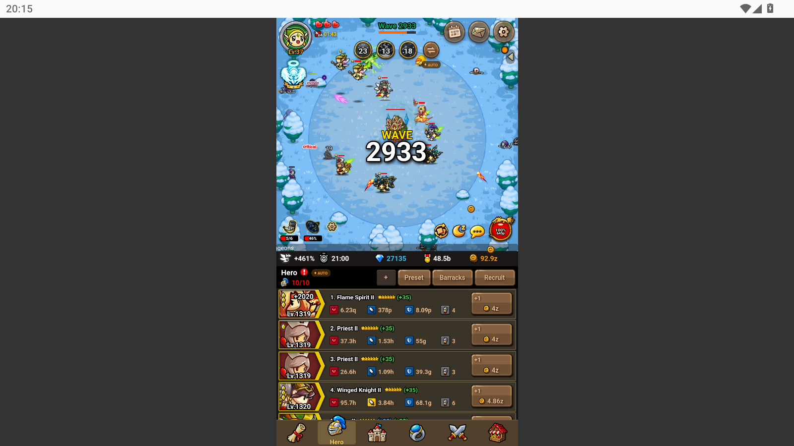
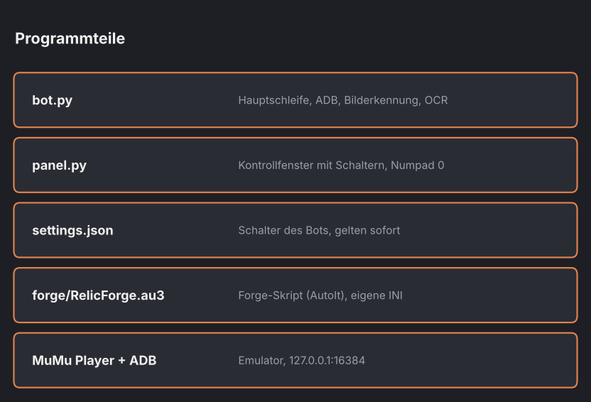
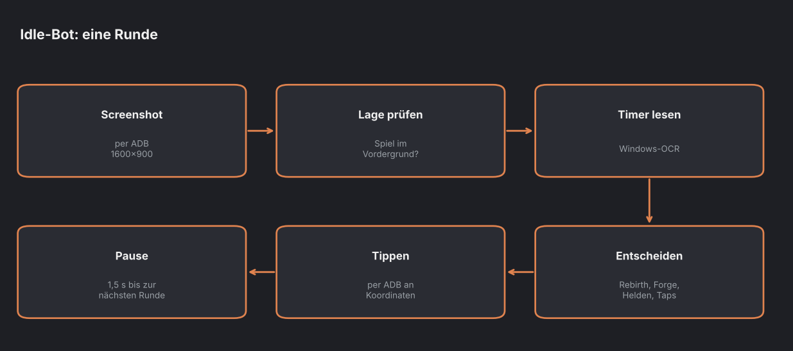
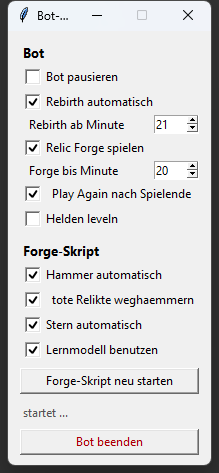

# Idle-Bot für Endless Frontier 2 – Dokumentation

**Python-Hilfsprogramm, das das Idle-Spiel Endless Frontier 2 (EF2) im Emulator MuMu Player über ADB bedient.** Es macht Screenshots, erkennt per Bildanalyse und Texterkennung, was auf dem Bildschirm ist, und tippt entsprechend. So laufen wiederkehrende Aufgaben von selbst.

> Nur Dokumentation, kein Quellcode.

## Inhalt

| Seite | Thema |
|---|---|
| [docs/einrichtung.md](docs/einrichtung.md) | Voraussetzungen und erster Start |
| [docs/funktionen.md](docs/funktionen.md) | Alle Abläufe im Detail |
| [docs/bedienung.md](docs/bedienung.md) | Kommandozeile und Kontrollpanel |
| [docs/einstellungen.md](docs/einstellungen.md) | settings.json und Konstanten |
| [docs/technik.md](docs/technik.md) | ADB, Bilderkennung, OCR |
| [docs/grenzen.md](docs/grenzen.md) | Grenzen und Hinweise |

## Aufbau

## Eine Runde

Der Bot arbeitet in Runden mit einer Pause von 1,5 Sekunden. In jeder Runde prüft er zuerst, ob das Spiel im Vordergrund ist, erledigt dann die fälligen Aufgaben und tippt.

## Kontrollpanel

Ein kleines Fenster mit Schaltern für den Bot und für das Forge-Skript. Mit **Numpad 0** (NumLock an) lässt es sich ein- und ausblenden.
