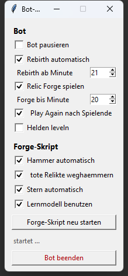

# Bedienung

## Kommandozeile

| Aufruf | Wirkung |
|---|---|
| `python bot.py` | Bot starten, Strg+C beendet |
| `python bot.py shot` | Screenshot nach `shots/latest.png` |
| `python bot.py tap X Y` | Einmal an eine Koordinate tippen |
| `python bot.py once` | Genau eine Runde, zum Testen |

Koordinaten beziehen sich auf einen Screenshot von 1600×900 im Querformat.

## Kontrollpanel

Ein- und ausblenden mit **Numpad 0** (NumLock an).

### Abschnitt „Bot“

| Schalter | Wirkung |
|---|---|
| Bot pausieren | Hält alle Aktionen an |
| Rebirth automatisch | Rebirth ab der eingestellten Minute |
| Rebirth ab Minute | Wert des Timers, ab dem der Rebirth startet |
| Relic Forge spielen | Forge-Minispiel automatisch öffnen und spielen |
| Forge bis Minute | Bis zu dieser Minute wird Forge gespielt |
| Play Again nach Spielende | Nach „Run Over“ neues Spiel starten |
| Helden leveln | Aktive „+1“-Buttons tippen |

### Abschnitt „Forge-Skript“

| Schalter | Wirkung |
|---|---|
| Hammer automatisch | Das Forge-Skript entscheidet selbst über Hämmer |
| tote Relikte weghämmern | Nicht mehr spawnende Relikte werden gehämmert |
| Stern automatisch | Stern-Automatik des Skripts |
| Lernmodell benutzen | Zusatzmodell des Skripts |
| Forge-Skript neu starten | Startet das Skript mit den neuen Schaltern |
| Bot beenden | Beendet den Bot |

Die Schalter des Bots gelten **sofort** und werden in `settings.json` gespeichert. Die Forge-Schalter stehen in `RelicForge.ini` und gelten **nach einem Neustart** des Forge-Skripts.
