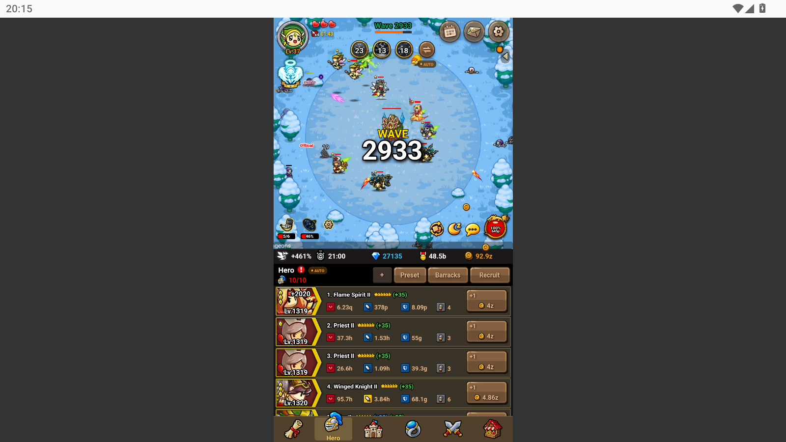

# Funktionen

## Helden leveln

Der Bot erkennt aktive **„+1“-Buttons** in den sichtbaren Heldenzeilen und tippt sie mehrfach (`TAPS_PER_BUTTON`, Standard 3 pro Runde). Optional scrollt er die Liste, um weitere Helden zu erreichen (`SCROLL_LIST`, `SCROLL_STEPS`). Ein Button gilt als aktiv, wenn er braun und gesättigt ist (bezahlbar), grau bedeutet nicht bezahlbar. Der Schalter heißt im Panel „Helden leveln“.

## Periodische Taps

Feste Positionen werden im eingestellten Intervall getippt, zum Beispiel für Fähigkeiten, Chat-Bonus und Wut. Die Liste steht in `PERIODIC_TAPS`.

## Rebirth

1. Der Bot liest per **Windows-OCR** den Timer neben dem Stoppuhr-Symbol.
2. Ab einer einstellbaren **Minute** (Panel: „Rebirth ab Minute“) öffnet er den Rebirth-Dialog über das Engel-Symbol.
3. Vor dem Klick prüft er als Sicherheitscheck, ob der richtige Dialog offen ist (grüner Button an der erwarteten Stelle und das Wort „Rebirth“ im Bild). Wenn nicht, bricht er ab und schließt den Dialog.
4. Er klickt den **grünen Rebirth-Button** (nicht den roten Diamanten-Button) und wartet bis zu 60 Sekunden auf die Bestätigung („Confirm“, wegen der Animation).
5. Danach wechselt er zurück zum Helden-Tab.

## Relic Forge

1. Bis zu einer einstellbaren Minute („Forge bis Minute“) öffnet der Bot das Relic-Forge-Minispiel. Dazu klappt er bei Bedarf das Seitenmenü auf und tippt das Konfetti-Symbol.
2. Er startet das **AutoIt-Skript**, das die Züge berechnet (siehe [Relic-Forge-Doku](https://github.com/lulu-830/RelicForge-Overlay-Doku)). Die Bildaufnahme läuft dabei per ADB im Hintergrund.
3. Während des Spiels prüft er regelmäßig, ob der Ergebnisbildschirm **„Run Over“** erscheint.
4. Optional („Play Again nach Spielende“) startet er ein neues Spiel, solange die Minute noch nicht erreicht ist.
5. Danach verlässt er die Forge über das rote X.

## Spiel im Vordergrund

Der Bot prüft, ob das Spiel im Vordergrund ist, und holt das MuMu-Fenster bei Bedarf nach vorn.
